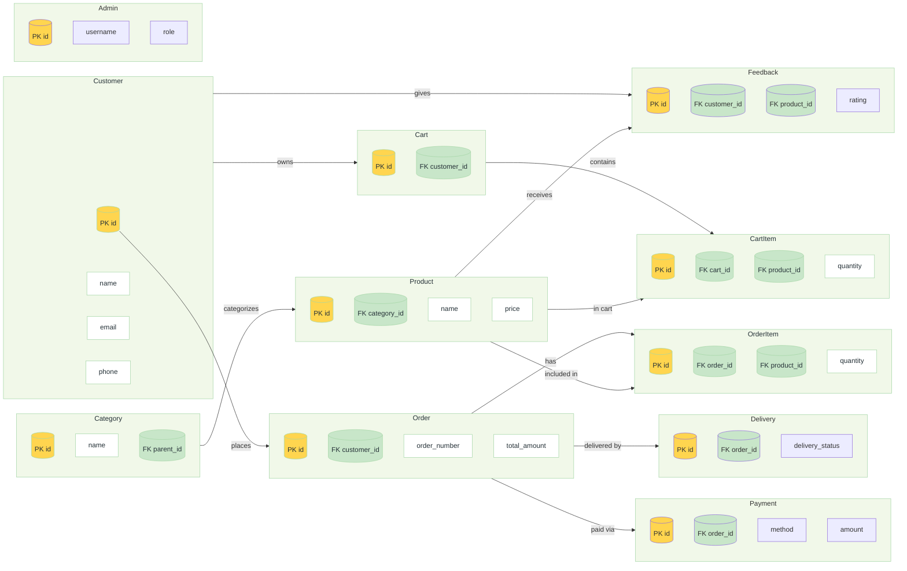

# Organic Farming — Database Schema & ER Diagram

Project: Organic Farming E‑Commerce Management System

Palette (use in reports/slides):
- Project Title: Dark Forest Green (#1B5E20)
- Table Headers: Organic Green (#2E7D32)
- Header Text: White (#FFFFFF)
- Primary Keys (PK): Soft Gold (#FFD54F)
- Foreign Keys (FK): Light Green (#C8E6C9)
- Table Background: Very Light Green (#F1F8E9)
- Borders: Gray-Green (#A5D6A7)
- Text: Dark Gray (#263238)

---

## Overview
This document defines a professional, normalized relational schema for the Organic Farming e‑commerce system and provides a visual ER diagram (Mermaid) styled to the requested agriculture theme. The design is normalized for clarity and reporting and suitable for an MCA final-year project report and viva.

Design goals:
- Clear PK/FK relationships
- Auditable created/updated timestamps
- Support for carts, itemized orders, payments, delivery and feedback
- Admin table for site operators

---

## Tables (concise definitions)

All `id` fields are integer primary keys (auto-increment). Timestamps use `DATETIME` / `TIMESTAMP`.

1) Customer
- `id` PK
- `name` VARCHAR(150) NOT NULL
- `email` VARCHAR(254) UNIQUE NOT NULL
- `phone` VARCHAR(20) NOT NULL
- `address` TEXT
- `city` VARCHAR(100)
- `pincode` VARCHAR(12)
- `created_at` DATETIME DEFAULT CURRENT_TIMESTAMP
- `updated_at` DATETIME

2) Category
- `id` PK
- `name` VARCHAR(100) NOT NULL
- `slug` VARCHAR(120) UNIQUE
- `description` TEXT
- `parent_id` FK -> Category(id) NULL (for category hierarchy)
- `created_at`, `updated_at`

3) Product
- `id` PK
- `category_id` FK -> Category(id)
- `name` VARCHAR(200) NOT NULL
- `sku` VARCHAR(64) UNIQUE
- `description` TEXT
- `price` DECIMAL(10,2) NOT NULL
- `stock` INT DEFAULT 0
- `image` VARCHAR(300)
- `created_at`, `updated_at`

4) Cart
- `id` PK
- `customer_id` FK -> Customer(id)
- `created_at`, `updated_at`
- Note: cart contents are stored in `cart_items` table to normalize

5) CartItem
- `id` PK
- `cart_id` FK -> Cart(id)
- `product_id` FK -> Product(id)
- `quantity` INT NOT NULL DEFAULT 1
- `unit_price` DECIMAL(10,2) NOT NULL
- unique(cart_id, product_id)

6) Order
- `id` PK
- `customer_id` FK -> Customer(id)
- `order_number` VARCHAR(40) UNIQUE NOT NULL
- `total_amount` DECIMAL(10,2) NOT NULL
- `status` VARCHAR(30) NOT NULL DEFAULT 'pending'  -- (pending, confirmed, shipped, delivered, cancelled)
- `payment_id` FK -> Payment(id) NULL
- `delivery_id` FK -> Delivery(id) NULL
- `created_at`, `updated_at`

7) OrderItem
- `id` PK
- `order_id` FK -> Order(id)
- `product_id` FK -> Product(id)
- `quantity` INT NOT NULL
- `unit_price` DECIMAL(10,2) NOT NULL
- `subtotal` DECIMAL(10,2) NOT NULL -- computed: quantity * unit_price

8) Payment
- `id` PK
- `order_id` FK -> Order(id) UNIQUE (one-to-one)
- `method` VARCHAR(30) NOT NULL -- (cod, gpay, phonepay, card, wallet)
- `amount` DECIMAL(10,2) NOT NULL
- `status` VARCHAR(30) NOT NULL DEFAULT 'pending' -- (pending, paid, failed, refunded)
- `transaction_ref` VARCHAR(200)
- `paid_at` DATETIME NULL
- `created_at`, `updated_at`

9) Delivery
- `id` PK
- `order_id` FK -> Order(id) UNIQUE
- `recipient_name` VARCHAR(150)
- `phone` VARCHAR(20)
- `address` TEXT
- `city` VARCHAR(100)
- `pincode` VARCHAR(12)
- `delivery_status` VARCHAR(30) DEFAULT 'pending' -- (pending, shipped, out_for_delivery, delivered, returned)
- `tracking_number` VARCHAR(120)
- `shipped_at` DATETIME NULL
- `delivered_at` DATETIME NULL
- `created_at`, `updated_at`

10) Admin
- `id` PK
- `username` VARCHAR(150) UNIQUE
- `full_name` VARCHAR(150)
- `email` VARCHAR(254) UNIQUE
- `role` VARCHAR(50) -- (superadmin, manager, support)
- `phone` VARCHAR(20)
- `created_at`, `updated_at`

11) Feedback
- `id` PK
- `customer_id` FK -> Customer(id)
- `product_id` FK -> Product(id) NULL
- `order_id` FK -> Order(id) NULL
- `rating` INT CHECK (rating BETWEEN 1 AND 5)
- `comment` TEXT
- `created_at` DATETIME

---

## Referential integrity & indexes (high-level)
- FK constraints between Product.category_id → Category.id
- FK constraints between Order.customer_id → Customer.id
- FK constraints between OrderItem.order_id → Order.id, OrderItem.product_id → Product.id
- Unique indexes on `email` (Customer), `sku` (Product), `order_number` (Order)
- Composite index on CartItem(cart_id, product_id)
- Use ON DELETE CASCADE for OrderItems when Order deleted; use ON DELETE SET NULL for Payment, Delivery references if necessary.

---

## Example SQL DDL (concise, compatible with MySQL/Postgres)

```sql
CREATE TABLE customer (
  id SERIAL PRIMARY KEY,
  name VARCHAR(150) NOT NULL,
  email VARCHAR(254) NOT NULL UNIQUE,
  phone VARCHAR(20) NOT NULL,
  address TEXT,
  city VARCHAR(100),
  pincode VARCHAR(12),
  created_at TIMESTAMP DEFAULT CURRENT_TIMESTAMP,
  updated_at TIMESTAMP
);

CREATE TABLE category (
  id SERIAL PRIMARY KEY,
  name VARCHAR(100) NOT NULL,
  slug VARCHAR(120) UNIQUE,
  description TEXT,
  parent_id INT REFERENCES category(id) ON DELETE SET NULL,
  created_at TIMESTAMP DEFAULT CURRENT_TIMESTAMP,
  updated_at TIMESTAMP
);

CREATE TABLE product (
  id SERIAL PRIMARY KEY,
  category_id INT REFERENCES category(id) ON DELETE SET NULL,
  name VARCHAR(200) NOT NULL,
  sku VARCHAR(64) UNIQUE,
  description TEXT,
  price DECIMAL(10,2) NOT NULL,
  stock INT DEFAULT 0,
  image VARCHAR(300),
  created_at TIMESTAMP DEFAULT CURRENT_TIMESTAMP,
  updated_at TIMESTAMP
);

CREATE TABLE cart (
  id SERIAL PRIMARY KEY,
  customer_id INT REFERENCES customer(id) ON DELETE CASCADE,
  created_at TIMESTAMP DEFAULT CURRENT_TIMESTAMP,
  updated_at TIMESTAMP
);

CREATE TABLE cart_item (
  id SERIAL PRIMARY KEY,
  cart_id INT REFERENCES cart(id) ON DELETE CASCADE,
  product_id INT REFERENCES product(id) ON DELETE RESTRICT,
  quantity INT NOT NULL DEFAULT 1,
  unit_price DECIMAL(10,2) NOT NULL,
  UNIQUE(cart_id, product_id)
);

CREATE TABLE "order" (
  id SERIAL PRIMARY KEY,
  customer_id INT REFERENCES customer(id) ON DELETE SET NULL,
  order_number VARCHAR(40) UNIQUE NOT NULL,
  total_amount DECIMAL(10,2) NOT NULL,
  status VARCHAR(30) NOT NULL DEFAULT 'pending',
  payment_id INT,
  delivery_id INT,
  created_at TIMESTAMP DEFAULT CURRENT_TIMESTAMP,
  updated_at TIMESTAMP
);

CREATE TABLE order_item (
  id SERIAL PRIMARY KEY,
  order_id INT REFERENCES "order"(id) ON DELETE CASCADE,
  product_id INT REFERENCES product(id) ON DELETE RESTRICT,
  quantity INT NOT NULL,
  unit_price DECIMAL(10,2) NOT NULL,
  subtotal DECIMAL(10,2) NOT NULL
);

CREATE TABLE payment (
  id SERIAL PRIMARY KEY,
  order_id INT REFERENCES "order"(id) ON DELETE CASCADE,
  method VARCHAR(30) NOT NULL,
  amount DECIMAL(10,2) NOT NULL,
  status VARCHAR(30) NOT NULL DEFAULT 'pending',
  transaction_ref VARCHAR(200),
  paid_at TIMESTAMP,
  created_at TIMESTAMP DEFAULT CURRENT_TIMESTAMP,
  updated_at TIMESTAMP
);

CREATE TABLE delivery (
  id SERIAL PRIMARY KEY,
  order_id INT REFERENCES "order"(id) ON DELETE CASCADE,
  recipient_name VARCHAR(150),
  phone VARCHAR(20),
  address TEXT,
  city VARCHAR(100),
  pincode VARCHAR(12),
  delivery_status VARCHAR(30) DEFAULT 'pending',
  tracking_number VARCHAR(120),
  shipped_at TIMESTAMP,
  delivered_at TIMESTAMP,
  created_at TIMESTAMP DEFAULT CURRENT_TIMESTAMP,
  updated_at TIMESTAMP
);

CREATE TABLE admin (
  id SERIAL PRIMARY KEY,
  username VARCHAR(150) UNIQUE,
  full_name VARCHAR(150),
  email VARCHAR(254) UNIQUE,
  role VARCHAR(50),
  phone VARCHAR(20),
  created_at TIMESTAMP DEFAULT CURRENT_TIMESTAMP,
  updated_at TIMESTAMP
);

CREATE TABLE feedback (
  id SERIAL PRIMARY KEY,
  customer_id INT REFERENCES customer(id) ON DELETE CASCADE,
  product_id INT REFERENCES product(id) ON DELETE SET NULL,
  order_id INT REFERENCES "order"(id) ON DELETE SET NULL,
  rating INT CHECK (rating >= 1 AND rating <= 5),
  comment TEXT,
  created_at TIMESTAMP DEFAULT CURRENT_TIMESTAMP
);
```

---

## Mermaid ER Diagram (copy into Markdown that supports Mermaid or into mermaid.live)



---

## How to use
- Paste the Mermaid block into a Markdown viewer that supports Mermaid (GitHub does not render Mermaid by default) or use https://mermaid.live to get a high-resolution PNG/SVG for your report.
- Use the SQL DDL to create your schema in Postgres or MySQL. Adjust `SERIAL` vs `AUTO_INCREMENT` for engine.

---

## Next steps (suggested)
- Export mermaid diagram into SVG/PNG for your report
- Prepare an ER diagram image and include in the viva slides
- Optionally add audit fields (`created_by`, `updated_by`) and soft-delete flags (`is_active`) if required


*File generated by assistant — edit as needed for final report.*
